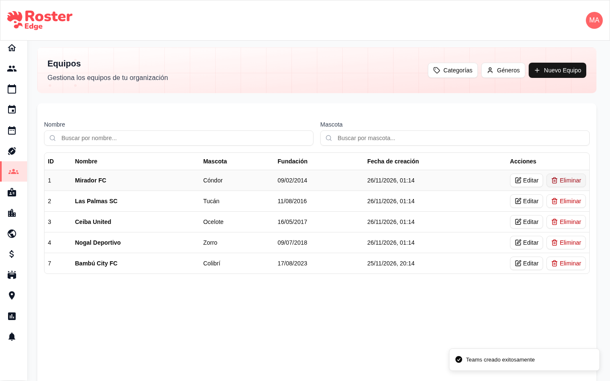
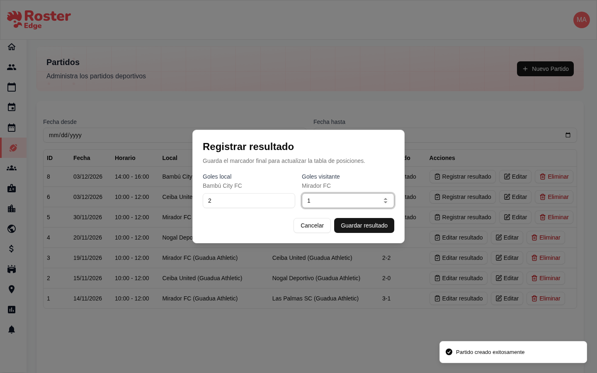
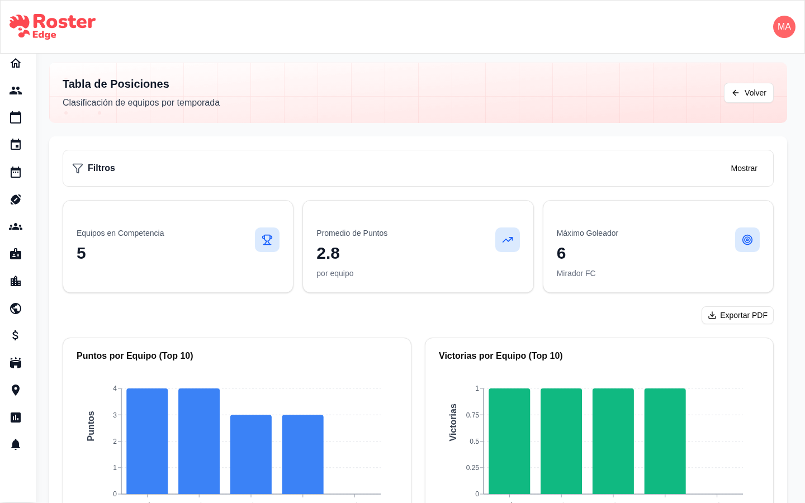
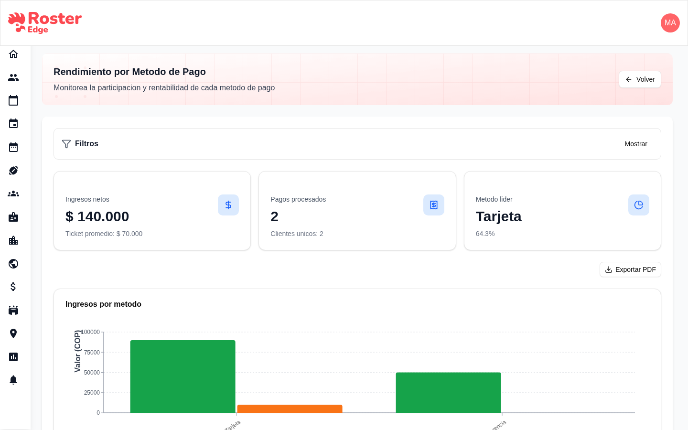
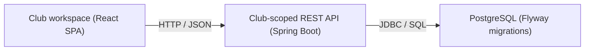

<!-- markdownlint-disable-next-line MD041 -->
<div align="center">

<h1>RosterEdge</h1>

<p><strong>Teams, fixtures, and standings for sports club staff.</strong></p>

<p>
<a href="https://github.com/diegnghtmr/roster-edge/actions/workflows/ci.yml"></a>


<a href="LICENSE"></a>
</p>

<p>
<a href="https://diegnghtmr.me/en/work/roster-edge/"><strong>Case study</strong></a> &bull;
<a href="#quick-start"><strong>Quick start</strong></a> &bull;
<a href="#architecture"><strong>Architecture</strong></a>
</p>

</div>

<p align="center"></p>

A scheduled fixture belongs on the calendar, but it should not count in the standings until someone records the score. RosterEdge keeps team and staff records, fixture scheduling, and club reports in one workspace. Staff can record results from the fixture list and export standings and financial reports to PDF.

## Features

- **Team and staff directories.** Organize teams by category and assign catalog roles to club staff.
- **Match scheduling.** Choose the event, venue, start and end times, and home and away teams in one form.
- **Result entry.** Record or correct a final score without reopening the scheduling form.
- **Season reporting.** Review standings, scoring, and schedule density without counting unplayed fixtures as 0–0 draws.
- **Payment reports.** Compare payments by method or subscription plan and export reports as PDFs.
- **Club-scoped access.** Sign in with a roster account tied to your club; the API checks access independently of browser navigation.
- **Spanish and English.** The app includes translations for both languages.

## Preview

These screenshots show the running app with fictional club data.



*Record a final score from the match list.*



*Standings count finalized results and can be exported to PDF.*



*Compare net revenue and payment counts by payment method.*

## Quick start

Use **Node.js 22** with npm, **JDK 21**, and **PostgreSQL 17** with `psql`. The backend includes a Maven wrapper. Start PostgreSQL and create a disposable database and a role with permission to create tables, sequences, and schemas.

| Variable | Purpose | Default |
| --- | --- | --- |
| `POSTGRES_DB` | Database name | `roster_db` |
| `POSTGRES_PORT` | Local PostgreSQL port | `5431` |
| `POSTGRES_USER`, `POSTGRES_PASSWORD` | Database credentials | Required |
| `SPRING_PROFILES_ACTIVE` | Use `dev` for local development | No active profile |
| `VITE_BACKEND_URL` | Frontend API base URL including `/api`, without a trailing slash | Required |

The example uses PostgreSQL on port `5432`. Substitute your local database and role names if they differ, then start the API:

```bash
git clone https://github.com/diegnghtmr/roster-edge.git
cd roster-edge
export POSTGRES_DB=rosteredge_demo POSTGRES_PORT=5432 POSTGRES_USER=roster_local
read -rs -p 'Local PostgreSQL password: ' POSTGRES_PASSWORD; printf '\n'
export POSTGRES_PASSWORD
export SPRING_PROFILES_ACTIVE=dev
cd backend
./mvnw spring-boot:run -Dspring-boot.run.arguments=--server.address=127.0.0.1
```

The API base is `http://127.0.0.1:8081/api`, with a public `GET /api/health/` endpoint. Flyway migrates the database on startup; it does not create demo accounts or populate catalogs.

In a second terminal, from the checkout:

```bash
cd frontend
npm ci
VITE_BACKEND_URL=http://127.0.0.1:8081/api npm run dev -- --host 127.0.0.1 --port 5173 --strictPort
```

Open `http://127.0.0.1:5173`. To try the app without provisioning an account, [import the synthetic demo](docs/database.md#optional-synthetic-demo) into the empty local database.

## Architecture

The browser calls the Spring Boot API over HTTP/JSON; only the API connects to PostgreSQL. React Router guards and lazy-loads routes, so charts load with their reports and the PDF renderer loads on export. The API derives club scope from the roster session and commits match scheduling, team assignments, and the in-app notification in one transaction.



## Tech stack

| Layer | Technology |
| --- | --- |
| Web app | React 19, TypeScript, Vite, React Router, TanStack Query |
| Reports and exports | Recharts, React PDF |
| API | Java 21, Spring Boot 3.5, Spring Data JDBC |
| Database | PostgreSQL 17, Flyway |
| Testing | JUnit with PostgreSQL, Vitest and Testing Library, Playwright and Chromium |

## Testing

Keep the database credentials exported as above, but point `POSTGRES_DB` at a separate disposable database. From the repository root:

```bash
(cd backend && SPRING_PROFILES_ACTIVE=test ./mvnw -B verify)
(cd frontend && npm ci && NODE_OPTIONS=--no-experimental-webstorage npm run test -- --run)
(cd frontend && npm run lint)
(cd frontend && VITE_BACKEND_URL=http://127.0.0.1:8081/api npm run build)
```

Backend tests cover empty schemas, restarts, authorization, rollback, and report correctness. CI runs the backend and frontend suites, builds the frontend, and runs a [Chromium smoke test](docs/testing/README.md) against the packaged API and built frontend on pushes and pull requests targeting `main`.

## Documentation

- [API, staff roles, and club scoping](docs/api.md) — session lifecycle, key routes, and match result rules.
- [Configuration](docs/configuration.md) — environment variables, built frontend preview, and CORS.
- [Database and demo data](docs/database.md) — Flyway, disposable fixtures, and a result-entry walkthrough.
- [Packaged browser smoke](docs/testing/README.md) — how to run the Chromium checks and capture screenshots.

## Team

RosterEdge is a team project. Contributors credited in the repository history:

- [Diego Alejandro Flores Quintero (`diegnghtmr`)](https://github.com/diegnghtmr)
- [Edwin Viña R (`ecodant`)](https://github.com/ecodant)
- [`Spalax-dev`](https://github.com/spalax-dev)
- [`Jorge-ivan-aa`](https://github.com/diegnghtmr/roster-edge/commit/3cc0523) (Git author name)

## License

RosterEdge is licensed under the [MIT License](LICENSE).
